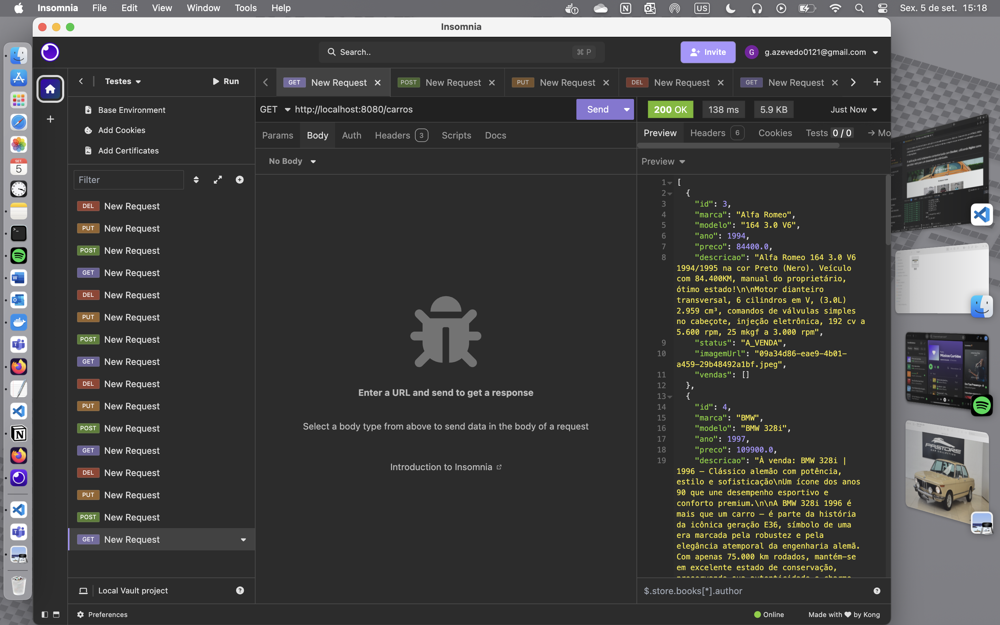

# Classic Car Concessionária - API Backend



Esta é a API RESTful para a aplicação de concessionária de carros clássicos. Desenvolvida inteiramente em **Java** com o framework **Spring Boot**, esta API é responsável por toda a lógica de negócio, gestão de dados e persistência num banco de dados **PostgreSQL**.

O projeto foi construído seguindo as melhores práticas de arquitetura em camadas e está totalmente contentorizado com **Docker** para garantir um ambiente de desenvolvimento e produção consistente e facilmente replicável.

---

## Tecnologias Utilizadas

- **Java 17+**: Versão da linguagem de programação.
- **Spring Boot 3.x**: Framework principal para a construção da aplicação.
  - Spring Web: Para a criação de endpoints RESTful.
  - Spring Data JPA: Para a persistência de dados e comunicação com a base de dados.
  - Validation: Para a validação dos dados de entrada.
- **PostgreSQL**: Sistema de gestão de base de dados relacional.
- **Hibernate**: Implementação do JPA para o mapeamento objeto-relacional (ORM).
- **Maven**: Ferramenta para gestão de dependências e build do projeto.
- **Lombok**: Biblioteca para reduzir código boilerplate (getters, setters, etc.).
- **Docker & Docker Compose**: Para a contentorização da aplicação e da base de dados.

---

## Estrutura do Projeto

```plaintext
classic-car-api/
├── src/main/java/com/example/classic_car_crud_api/
│   ├── config/
│   │   ├── CorsConfig.java    # Configuração de CORS para permitir requisições do frontend.
│   │   └── WebConfig.java     # Configuração para servir as imagens da pasta /uploads.
│   │
│   ├── controller/
│   │   ├── CarroAntigoController.java # Endpoints para o CRUD de Carros.
│   │   ├── ClienteController.java     # Endpoints para o CRUD de Clientes.
│   │   ├── VendaController.java       # Endpoints para o CRUD de Vendas.
│   │   └── VendedorController.java    # Endpoints para o CRUD de Vendedores.
│   │
│   ├── exception/
│   │   ├── BusinessRuleException.java   # Exceção para erros de regra de negócio.
│   │   └── ResourceNotFoundException.java # Exceção para quando um recurso não é encontrado.
│   │
│   ├── model/
│   │   ├── CarroAntigo.java   # Entidade JPA que representa a tabela de carros.
│   │   ├── Cliente.java       # Entidade JPA para a tabela de clientes.
│   │   ├── Venda.java         # Entidade JPA para a tabela de vendas.
│   │   └── Vendedor.java      # Entidade JPA para a tabela de vendedores.
│   │
│   ├── repository/
│   │   └── (Interfaces Spring Data JPA para cada entidade)
│   │
│   ├── service/
│   │   └── (Classes com a lógica de negócio para cada entidade)
│   │
│   └── ClassicCarCrudApiApplication.java # Classe principal que inicia a aplicação.
│
├── src/main/resources/
│   └── application.properties # Ficheiro de configuração.
│
├── uploads/ # Pasta onde as imagens dos carros são guardadas.
│
└── Dockerfile # Instruções para construir a imagem Docker.
```

---

## Modelo de Dados e Relacionamentos

A persistência de dados é gerida pelo **Spring Data JPA**, que mapeia as nossas classes Java (Entidades) para tabelas no **PostgreSQL**. A entidade **Venda** é o centro do nosso modelo de negócio, conectando as outras três entidades principais.

- **Venda e CarroAntigo**: Uma venda está associada a um carro, mas um carro pode estar em muitas vendas (embora a nossa regra de negócio limite para apenas uma). (**ManyToOne**)
- **Venda e Cliente**: Uma venda está associada a um cliente, e um cliente pode ter muitas vendas. (**ManyToOne**)
- **Venda e Vendedor**: Uma venda está associada a um vendedor, e um vendedor pode ter muitas vendas. (**ManyToOne**)

Graças ao **Hibernate**, as anotações `@ManyToOne` e `@JoinColumn` nas nossas entidades criam automaticamente as chaves estrangeiras (**foreign keys**) na tabela **venda**, garantindo a integridade dos dados.

---

## Como Executar

A aplicação foi desenhada para ser executada com **Docker** e **Docker Compose**, o que simplifica enormemente a configuração do ambiente.

- **Pré-requisitos**: Ter o Docker e o Docker Compose instalados.
- **Configuração**: Na raiz do projeto, certifique-se de que tem um ficheiro `.env` com as suas credenciais da base de dados.

```bash
DB_NAME=concessionaria
DB_USERNAME=seu_usuario_postgres
DB_PASSWORD=sua_senha_postgres
DB_HOST=db
DB_PORT=5432
```

- **Comando de Execução** : Navegue até à pasta raiz do projeto (onde está o docker-compose.yml) e execute:

```bash
docker compose up --build -d
```
- **A API estará disponível no endereço: http://localhost:8080**

---
## Testar os Endpoints

Todos os endpoints de **CRUD** (`GET`, `POST`, `PUT`, `DELETE`) para as quatro entidades (**Carros, Clientes, Vendedores, Vendas**) foram testados e estão totalmente funcionais.

A funcionalidade mais complexa para testar é o **upload de imagens**, que requer uma requisição `multipart/form-data`.

---

### 1. Testar com cURL (Mais Fácil)

Abra o terminal e execute:

```bash
curl -X POST http://localhost:8080/carros \
-F "file=@/Users/gabrielazevedo/Documents/imagem.png" \
-F 'carro={ "marca": "Ford", "modelo": "Mustang", "ano": 1970, "preco": 150000.00, "descricao": "Um clássico muscle car americano." };type=application/json'
```
### Análise:

- `-F` anexa partes a um formulário.  
- O `@` indica um ficheiro.  
- O `type=application/json` é crucial para que o **Spring Boot** entenda que a parte `carro` é um objeto **JSON**.  

---

## Como Conferir no Banco de Dados (PostgreSQL)

Como a base de dados está num **container Docker**, podemos acessar com:

```bash
docker exec -it postgres_db_concessionaria psql -U seu_usuario_postgres -d concessionaria
```

Substitua **`seu_usuario_postgres`** pelo valor de **`DB_USERNAME`** definido no arquivo `.env`.

---

## Comandos SQL Úteis

- **Listar todas as tabelas**:  
  ```sql
  \dt
  ```
- **Ver todos os carros**:
  ```sql
  SELECT * FROM carro_antigo;
  ````
- **Ver todas as vendas**:
  ```sql
  SELECT * FROM venda;
  ```
- **Sair do psql**:
  ```sql
  \q
  ```
---

## Conclusão

O **Classic Car Concessionária - API Backend** representa uma solução robusta e bem estruturada para a gestão de uma concessionária de carros clássicos.  
Construída com **Java 17** e **Spring Boot 3.x**, a aplicação segue as boas práticas de arquitetura em camadas, garantindo **organização, manutenção e escalabilidade**.  

A integração com **PostgreSQL** e **Spring Data JPA** assegura a persistência de dados de forma eficiente, enquanto o **Hibernate** cuida do mapeamento objeto-relacional.  
O uso de **Docker e Docker Compose** simplifica a configuração e disponibiliza um ambiente consistente para desenvolvimento e produção.  

Entre os principais destaques, estão:  
- **CRUD completo** para Carros, Clientes, Vendedores e Vendas.  
- **Upload de imagens** integrado ao fluxo de cadastro de carros.  
- **Validações** para garantir integridade e consistência nos dados.  
- **Modelo de dados centralizado na entidade Venda**, conectando clientes, vendedores e carros de forma eficiente.  

Com isso, o backend fornece uma base sólida e confiável para sustentar toda a aplicação, servindo como núcleo da lógica de negócio e garantindo que o frontend e demais consumidores de API tenham acesso a dados organizados e consistentes.  

