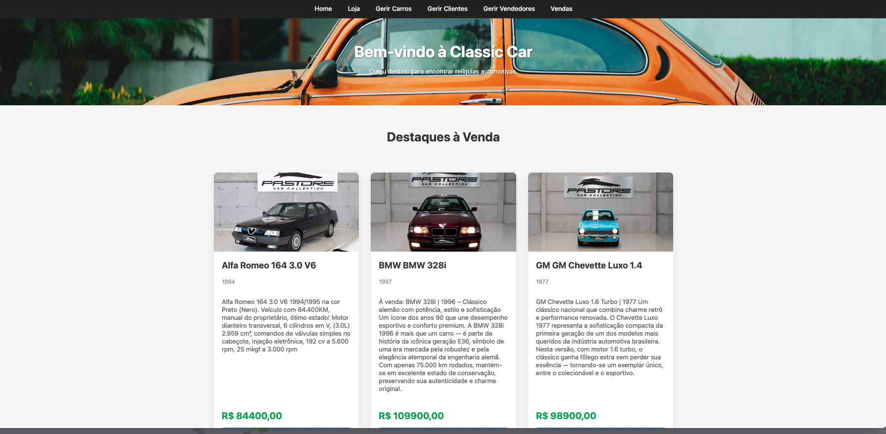

# Classic Car Concessionária - Frontend

Este é o projeto de frontend para a aplicação de concessionária de carros clássicos. Desenvolvido com **HTML5, CSS3 e JavaScript puro (ES6+)**, este frontend é uma interface dinâmica e responsiva que consome uma **API REST** construída em **Spring Boot**.

A aplicação está totalmente contentorizada com **Docker**, utilizando **Nginx** como servidor web para um desempenho otimizado.

---



---

## Créditos das Imagens

Todas as fotos de carros utilizadas no frontend foram obtidas do site [Pastor ECC - Carros Antigos e de Coleção](https://www.pastorecc.com.br/carros/antigos-e-colecao).  

> Nota: As imagens são usadas apenas para fins de demonstração e testes no frontend.
---


## Tecnologias Utilizadas

- **HTML5**: Estrutura semântica das páginas.
- **CSS3**: Estilização utilizando Flexbox e Grid para layouts modernos e responsivos.
- **JavaScript (ES6+)**: Manipulação do DOM, interatividade, chamadas de API (`fetch`) e lógica de negócio do lado do cliente.
- **Docker & Nginx**: Criação de ambiente de produção consistente e servir os ficheiros estáticos de forma eficiente.
- **IMask.js**: Biblioteca externa para máscaras de entrada em formulários, melhorando a experiência do utilizador.

---

## Estrutura do Projeto

```plaintext
classic-car-frontend/
├── css/
│   ├── admin.css       # Estilos para páginas de gestão (CRUD)
│   ├── loja.css        # Estilos para a vitrine de carros
│   ├── modal.css       # Estilos para o modal de confirmação
│   ├── style.css       # Estilos globais (navbar, banners, etc.)
│   └── vendas.css      # Estilos da página de vendas
│
├── js/
│   ├── carros.js       # CRUD de Carros (upload e máscaras)
│   ├── clientes.js     # CRUD de Clientes
│   ├── header.js       # Carrega cabeçalho dinamicamente
│   ├── loja.js         # Carrega carros na página da loja
│   ├── main.js         # Carrega carros na página principal
│   ├── vendedores.js   # CRUD de Vendedores
│   └── vendas.js       # Página de vendas (histórico e registo)
│
├── carros.html         # Gestão de Carros
├── clientes.html       # Gestão de Clientes
├── header.html         # Cabeçalho reutilizável
├── index.html          # Página principal / Destaques
├── loja.html           # Vitrine completa
├── vendedores.html     # Gestão de Vendedores
├── vendas.html         # Histórico e registo de Vendas
└── Dockerfile          # Construção da imagem Docker
```
## Principais Funcionalidades

- **Vitrine Dinâmica**: `index.html` e `loja.html` consomem `/carros` da API para exibir carros "A_VENDA" com fotos, preços e descrições.

- **Área de Gestão Completa (CRUD)**:
  - **Carros**: Adicionar, editar e excluir carros com upload de imagem.
  - **Clientes e Vendedores**: Gestão completa de registros.

- **Fluxo de Venda Inteligente**: Seleção de carro redireciona para página de vendas com dados preenchidos, agilizando o processo e mostrando histórico de vendas.

- **Componente de Cabeçalho Reutilizável**: `header.html` injetado dinamicamente em todas as páginas.

- **Melhorias de UX**:
  - Modal de confirmação para ações destrutivas.
  - Máscaras de entrada para CPF, telefone, matrícula, datas e valores monetários.

---

## Como Executar

**Pré-requisitos**: Docker e Docker Compose instalados.

**Localização**: Certifique-se de que `docker-compose.yml` está na pasta raiz, um nível acima de `classic-car-frontend/`.

**Comando de execução**:

```bash
docker compose up --build -d
```

## Dockerfile do Frontend

```dockerfile
# Estágio 1: Imagem base
FROM nginx:alpine

# Diretório de trabalho dentro do container
WORKDIR /usr/share/nginx/html

# Copia todos os ficheiros do projeto para o container
COPY . .

# Expõe a porta 80
EXPOSE 80

# Comando para iniciar o servidor Nginx
CMD ["nginx", "-g", "daemon off;"]
```
Explicações:

- FROM nginx:alpine: Imagem oficial do Nginx baseada em Alpine Linux, leve e otimizada para servir arquivos estáticos.

- WORKDIR /usr/share/nginx/html: Diretório padrão onde o Nginx procura os arquivos para servir.

- COPY . .: Copia todos os arquivos e pastas (css/, js/, *.html) do diretório local para o container.

- EXPOSE 80: Informa ao Docker que o container escutará na porta 80.

- CMD ["nginx", "-g", "daemon off;"]: Inicia o Nginx em primeiro plano, garantindo que o container permaneça ativo.- 

## Conclusão

O projeto **Classic Car Concessionária - Frontend** apresenta uma solução completa e moderna para a interface de uma concessionária de carros clássicos. Combinando **HTML5, CSS3, JavaScript (ES6+)** e **Docker**, o frontend é responsivo, dinâmico e integrado a uma API REST em Spring Boot, garantindo consistência e eficiência no consumo de dados.  

As principais vantagens do projeto incluem:

- **Experiência do Usuário Aprimorada**: Interfaces claras, modais de confirmação e máscaras de entrada que facilitam a interação do usuário.
- **Gestão Completa (CRUD)**: Ferramentas para administração de carros, clientes e vendedores de forma centralizada e intuitiva.
- **Fluxo de Vendas Otimizado**: Redirecionamento inteligente para vendas, permitindo agilidade e rastreabilidade das transações.
- **Arquitetura Modular e Reutilizável**: Cabeçalhos dinâmicos, CSS e JS separados por funcionalidades, facilitando manutenção e escalabilidade.
- **Deployment Simplificado com Docker**: Ambiente de produção consistente, rápido de configurar e fácil de replicar em diferentes máquinas.

Em resumo, este frontend proporciona uma **interface confiável, escalável e profissional**, pronta para integrar-se ao backend e oferecer uma experiência completa tanto para usuários quanto para administradores da concessionária.
